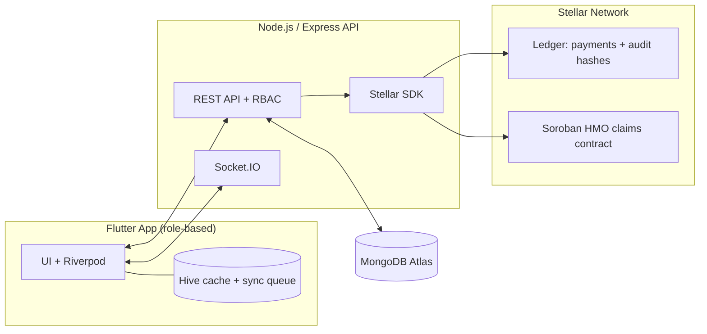

# MediLink Hospital Management System 🏥🔗

> **Less waiting. Safer care. One record.**
> A mobile-first hospital management system that connects every step of the patient journey, with the **Stellar blockchain** powering instant settlements, automated HMO claims, and verifiable audit trails.

    


---

## Table of Contents

- [Why MediLink](#why-medilink)
- [Features](#features)
- [How It Works](#how-it-works)
- [Tech Stack](#tech-stack)
- [User Roles](#user-roles)
- [Quick Start](#quick-start)
- [Configuration](#configuration)
- [Project Structure](#project-structure)
- [Blockchain Design & Privacy](#blockchain-design--privacy)
- [Testing](#testing)
- [CI/CD](#cicd)
- [Roadmap](#roadmap)
- [Contributing](#contributing)
- [Team](#team)
- [License](#license)

---

## Why MediLink

Many hospitals still run on paper records and disconnected departments, which means long queues, lost results, and fragmented care. Insurance payouts can take weeks, and families abroad have no easy way to fund a relative's treatment.

MediLink addresses this with **one secure mobile app** for patients, clinical staff, and administrators, and uses the **Stellar network** to remove payment and compliance friction:

| Problem | MediLink's answer |
|---|---|
| Hours lost in queues | QR check-in (target: under 2 minutes) and live queue positions |
| Paper and siloed records | One digital record, instantly available to authorized clinicians |
| Weeks-long HMO claim cycles | Soroban smart contracts that verify and pay claims automatically |
| Daily payment reconciliation | Instant stablecoin settlement |
| Hard-to-prove data access compliance | Hashed access logs anchored on the Stellar ledger |
| Expensive cross-border funding | Diaspora top-ups via Stellar anchors, converted to Naira |

---

## Features

### Core hospital modules

- **Registration & ID:** unique hospital ID and QR card for fast front-desk check-in.
- **Smart queueing:** book online or walk in; live queue position and wait estimates over WebSockets.
- **Digital medical records:** history, vitals, notes, and lab results, available to authorized doctors.
- **Connected lab & pharmacy:** paperless lab requests, automated worklists, instant results, legible e-prescriptions with stock checks.
- **Admin dashboard:** real-time patient flow, wait times, and revenue metrics.
- **Offline-first:** critical screens cache data locally and sync when connectivity returns.

### Stellar integrations 🪐

- **Instant stablecoin settlements:** consultation and lab payments settle in USDC or local stablecoins.
- **Automated HMO claims (Soroban):** a smart contract checks claim data against policy rules and releases payment to the hospital.
- **Verifiable audit trails:** each record access produces a hashed log entry anchored on-ledger, so any tampering with the off-chain log is detectable. Supports data-protection compliance efforts (e.g. NDPA 2023); it does not replace a legal compliance review.
- **Cross-border payments:** the diaspora can fund family wallets or specific invoices through Stellar anchors.

---

## How It Works



---

## Tech Stack

| Layer | Technology |
|---|---|
| **Mobile** | Flutter (Dart), Riverpod, `go_router` (role-based guards), Hive (offline cache + sync queue), Socket.IO client |
| **Backend** | Node.js, Express, MongoDB Atlas (Mongoose + transactions), Socket.IO, JWT, RBAC, rate limiting |
| **Blockchain** | Stellar (Testnet/Pubnet), Soroban smart contracts (Rust), Stellar Node.js SDK |
| **Payments** | Paystack (fiat), Stellar (stablecoins) |
| **DevOps** | GitHub Actions, Fastlane, Docker, AWS / Render |
| **QA** | Jest, Supertest, `flutter test`, Patrol (E2E), k6, OWASP ZAP |

---

## User Roles

One app shell routes each user to a dedicated dashboard.

| Role | What they do |
|---|---|
| **Patient** | Book appointments, see the live queue, view results and prescriptions, pay bills |
| **Front Desk** | Scan QR codes for check-in, assign patients to clinics |
| **Nurse** | Run the triage queue, record vitals (BP, SpO2, weight), flag urgent cases |
| **Doctor** | Review history, write notes and diagnoses, order labs, send e-prescriptions |
| **Lab Scientist** | Work paid requests from a unified worklist, enter results, flag abnormal values |
| **Pharmacist** | Receive e-prescriptions, check stock, dispense after payment confirmation |
| **Billing Officer** | Manage fiat/crypto invoices, NHIA/HMO claims, and digital receipts |
| **Admin** | Configure clinics, manage staff roles, monitor the live dashboard |

---

## Quick Start

### Prerequisites

- [Flutter SDK](https://docs.flutter.dev/get-started/install) 3.19+
- [Node.js](https://nodejs.org/) 18+
- [Docker & Docker Compose](https://www.docker.com/)
- [Stellar CLI](https://developers.stellar.org/docs/build/smart-contracts/getting-started/setup) (only for contract development)
- A MongoDB instance (local or Atlas). **Transactions require a replica set**; Atlas and the provided Docker setup satisfy this, a bare local `mongod` does not.

### 1. Clone

```bash
git clone https://github.com/your-org/medilink-hms.git
cd medilink-hms
```

### 2. Backend

```bash
cd backend
npm install
cp .env.example .env    # then fill in values (see Configuration)
npm run seed:demo       # populate demo dataset across all 8 roles (see DEMO.md)
npm run dev             # API on http://localhost:3000
```

Or run the API and database together with Docker:

```bash
docker compose up --build
```

### 3. Smart contracts (optional, blockchain contributors)

```bash
cd contracts/hmo_claims
stellar contract build
stellar contract deploy --network testnet
# Copy the returned contract ID into HMO_CONTRACT_ID in backend/.env
```

> Fund your testnet hospital account with [Friendbot](https://developers.stellar.org/docs/learn/fundamentals/networks#friendbot) before deploying.

### 4. Mobile app

```bash
cd frontend
flutter pub get
dart run build_runner build --delete-conflicting-outputs   # Riverpod + JSON codegen
flutter run
```

Point the app at your API by setting the base URL in the frontend config (use `http://10.0.2.2:3000` for the Android emulator).

---

## Configuration

Create `backend/.env` from `.env.example`.

| Variable | Description | Example |
|---|---|---|
| `PORT` | API port | `3000` |
| `NODE_ENV` | Environment | `development` |
| `MONGODB_URI` | MongoDB connection string | `mongodb+srv://<user>:<password>@cluster.mongodb.net/medilink` |
| `JWT_SECRET` | Secret for signing tokens | long random string |
| `JWT_EXPIRES_IN` | Token lifetime | `1d` |
| `PAYSTACK_SECRET_KEY` | Paystack key for fiat payments | `sk_test_...` |
| `SMS_API_KEY` | SMS provider key | `...` |
| `STELLAR_NETWORK` | `TESTNET` or `PUBLIC` | `TESTNET` |
| `STELLAR_HORIZON_URL` | Horizon endpoint | `https://horizon-testnet.stellar.org` |
| `SOROBAN_RPC_URL` | Soroban RPC endpoint | `https://soroban-testnet.stellar.org` |
| `HOSPITAL_STELLAR_SECRET` | Hospital account secret key | `S...` |
| `HMO_CONTRACT_ID` | Deployed claims contract ID | `C...` |

> In CI/CD, a separate MongoDB Atlas instance is provided via `MONGODB_URI_STAGING`.

---

## Project Structure

```text
medilink-hms/
├── backend/            # Node.js / Express API, Socket.IO, Stellar SDK, Jest test suite
│   ├── scripts/        # seed.js, seed_demo.js
│   ├── src/            # Models, routes, middleware, services, utils
│   └── tests/          # Jest & Supertest integration tests
├── frontend/           # Flutter mobile app
│   ├── android/fastlane/ # Android Fastlane lanes (store publishing disabled)
│   ├── ios/fastlane/     # iOS Fastlane lanes (store publishing disabled)
│   ├── integration_test/ # Patrol E2E patient journey test suite
│   ├── lib/            # Riverpod state, go_router guards, Hive offline sync, UI
│   └── test/           # Unit and widget test suite
├── contracts/
│   └── hmo_claims/     # Soroban (Rust) HMO claims smart contract
├── .github/workflows/  # pr.yml (PR checks) and deploy-staging.yml (staging + Patrol QA gate)
├── DEMO.md             # 10-minute walkthrough script following 8 roles in order
├── docker-compose.yml  # Local multi-service environment
└── README.md           # Single source of truth
```

---

## Blockchain Design & Privacy

Healthcare data is sensitive, so the chain is used only where it adds clear value:

- **No patient data on-chain.** Only cryptographic hashes (e.g. SHA-256 of an access event) and payment/claim amounts are written to Stellar. Medical records stay in MongoDB, encrypted and access-controlled.
- **Avoid identifiable hash inputs.** Hash inputs should include a per-event salt or use pseudonymous IDs so on-chain data cannot be linked back to a patient.
- **Audit verification.** To verify a log entry, recompute its hash from the off-chain record and compare it with the anchored value.
- **HMO claims.** The Soroban contract validates structured claim data against policy rules; ambiguous or high-value claims should fall back to manual review.
- **Network.** Develop and test on Testnet; Pubnet requires a security review of key management and contract code first.

---

## Testing

All stories must pass the QA gates before merging.

| Scope | Command |
|---|---|
| Backend unit & integration (Jest + Supertest) | `cd backend && npm test` |
| Frontend unit & widget | `cd frontend && flutter test` |
| End-to-end (Patrol) | `patrol test --target integration_test/patient_journey_test.dart` |
| Load testing (k6) | `k6 run scripts/load_test.js` |
| Security scan | OWASP ZAP, run automatically in CI |
| Contract tests | `cd contracts/hmo_claims && cargo test` |

---

## CI/CD

GitHub Actions drives the pipeline:

1. **Pull request:** `flutter analyze`, `flutter test`, ESLint, Jest. Requires a green build and at least 1 review.
2. **Staging:** merges to `main` build Docker images and deploy to Staging (separate MongoDB Atlas instance).
3. **QA gate:** automated E2E tests run against Staging.
4. **Release:** Fastlane ships AAB/IPA builds to Google Play and the App Store; production API images deploy to AWS/Render.

---

## Roadmap

- [x] Registration, QR check-in, and live queue
- [x] Digital records, lab, and pharmacy flows
- [x] Stablecoin payment settlement
- [x] Soroban HMO claims automation
- [x] On-chain audit anchoring
- [ ] Diaspora funding via Stellar anchors
- [ ] Pubnet launch after security audit

---

## Contributing

Contributions are welcome.

1. Fork the repo and create a branch: `git checkout -b feat/your-feature`
2. Make your changes with tests, and make sure `flutter analyze`, `flutter test`, `npm run lint`, and `npm test` pass.
3. Use [Conventional Commits](https://www.conventionalcommits.org/) (e.g. `feat: add lab result flagging`).
4. Open a pull request describing what changed and why.

Please report security vulnerabilities privately to **security@your-org.example** rather than opening a public issue.

---

## Team

| Role | Focus |
|---|---|
| Project Manager | Problem scoping, user needs, sprint planning |
| UI/UX Designer | Design system, Figma flows, accessibility |
| Front-end Developer | Flutter application |
| Back-end & Web3 Developer | Node.js API, Socket.IO queue, MongoDB, Stellar integrations |
| QA Engineer | Test strategy, E2E automation |
| DevOps | CI/CD, environments, monitoring |
| Emotional Officer | Team wellbeing and empathy-driven features (e.g. accessible UI for elderly patients) |

---

## License

Released under the [MIT License](LICENSE).

---

*Built with care to ensure a calm team and a calm product.* 💙
